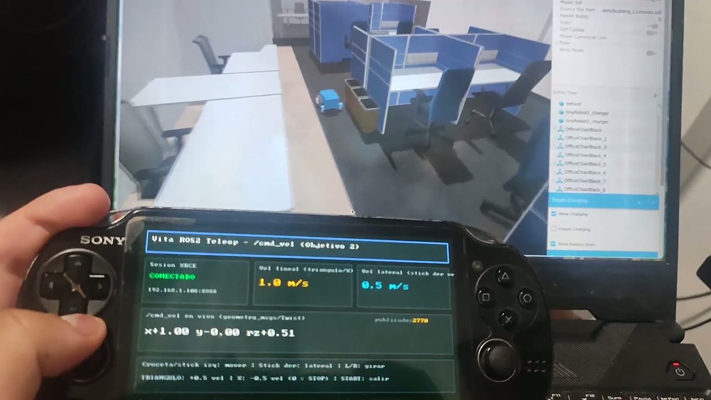

# PS Vita ↔ ROS2

Convertir una **PS Vita 1000** en un nodo real del ecosistema **ROS2 Jazzy**:
publica y recibe topics vía micro-ROS (XRCE-DDS) sobre WiFi/UDP, con cada
módulo de bajo nivel implementado **dos veces** (Rust y C/C++) tras un mismo
header C. Proyecto experimental de largo plazo con vocación de publicarse.

**Estado (2026-11-13):** Objetivos 1 (topics) y 2 (teleoperación) **cerrados en hardware** · **Godot 4**
(`godot4-vita` + la API de `rclgd` en el módulo estático `ros2_vita`; ADR 0008, `docs/18`): puertas **G1–G7c
verdes**, todas en hardware desde G4 (ida y vuelta XRCE con ROS 2 Jazzy, HMI de teleop con `/odom`, IMU calibrada y
primer 3D en la Vita a 59 FPS) · **producto vivo:** las apps Godot 4 `g1-unitree` (60 FPS en la Vita),
`g1-sensores` (57–58 FPS, perfil ligero), `rbkairos-plus` y `dron-mapeo`, sobre la biblioteca compartida
`godot/plantillas/` (robots, sensores ROS 2, mundo editable; docs 29, 34, 35) · **siguiente:** el visor de topics
en Godot (workshop W13 → doc 36/36a y ADR 0013, tareas V1–V15) · web del proyecto **en pausa** (decisión del
usuario, 2026-11-01). Detalle vivo en [`docs/06-bitacora-estado.md`](docs/06-bitacora-estado.md); índice de
toda la documentación en [`docs/README.md`](docs/README.md).

---

## 🎮 La Vita controlando un robot (2026-07-10)

Primer vídeo del hito del Objetivo 2: la app **"Vita ROS2 Teleop"** corriendo
en la consola, publicando `geometry_msgs/Twist` en `/cmd_vel` a ~20 Hz por
WiFi (XRCE-DDS → agente micro-ROS → grafo ROS2 Jazzy) y moviendo un robot
móvil en vivo, con la UI declarativa mostrando la conexión, las escalas de
velocidad y el Twist publicado:

[](media/2026-07-10-primer-control-robot-cmd_vel.mp4)

*(clic en la imagen para ver el vídeo — `media/…-cmd_vel.mp4`, 1 min)*

---

## Hitos conseguidos

| Fecha | Hito |
|---|---|
| 2026-06-28 | Cliente XRCE y los 3 módulos duales cross-compilan; `.vpk` C y Rust |
| 2026-07-01 | **Incógnita dura resuelta en hardware**: sesión XRCE Vita↔agente estable (el muro era la versión del protocolo, v2.4.3) + criterios de la Fase 1 en vivo |
| 2026-07-06 | Primer hito de la web: comparador C↔Rust, dashboard, visor URDF 3D, compilador `.vpk` y debug desde el navegador |
| 2026-07-07 | UI declarativa en la app (JSON → codegen → intérprete) + editor visual web |
| 2026-07-07 | **Objetivo 2 cerrado**: teleop `/cmd_vel` con sticks/botones (39 checks host del mapeo) |
| 2026-07-10 | **Objetivo 3 respondido con evidencia** (rviz2 no portable → ADR 0006: mini-rviz propio) |
| 2026-07-10 | **Modo VIZ 3D en la consola** (vitaGL, ADR 0007) + IP del agente editable desde la Vita + **robot móvil real controlado** (vídeo de arriba) |
| 2026-07-13 | **Migración a Godot (rama `godot-migration`):** módulo `microros` como módulo custom del engine, template `.vpk` compilado en el PC, y **teleop en Godot publicando `/cmd_vel` en hardware** (variante C completa, G1-G3) |
| 2026-10-30 | **Godot 4, G1–G6 verdes:** `ros2_vita` dentro de godot4-vita, ida y vuelta con ROS 2 Jazzy desde la Vita y HMI de teleop con `/odom` en hardware |
| 2026-11-01 | **G7a–G7c verdes:** IMU de la Vita calibrada en `/vita/imu`, visor 3D en el PC y primer 3D de Godot 4 en la propia Vita (59 FPS) |
| 2026-11-12 | Plantillas de robots y sensores ROS 2 (RB-KAIROS+, Unitree G1, dron) con diagnóstico de rendimiento XRCE (docs 29–30) |
| 2026-11-13 | `g1-sensores` de 23,5 a 57–58 FPS en la Vita (perfil ligero, doc 34); regla de escenas editables (doc 35); W13 → diseño del visor de topics (doc 36, ADR 0013); organización del repo (ADR 0014) |

---

## Máquinas

| Rol | Equipo | IP | Función |
|---|---|---|---|
| **Taller** | Laptop | 192.168.1.108 | Código portable, docs, web, MCP, tests host. En la Fase 1 corría el agente micro-ROS y recibía el netlog (histórico). |
| **Desarrollo** | PC CachyOS | 192.168.1.65 | VitaSDK: cross-compilación, empaquetado `.vpk`, deploy FTP y **agente micro-ROS** (estación `docker/vita-ros.sh up`, UDP 8888). |
| **Objetivo** | PS Vita 1000 | (WiFi) | ARM Cortex-A9 ×4 32-bit, 512 MB RAM. Homebrew vía VitaSDK. |

**Regla de frontera:** en la laptop se escribe y verifica todo lo verificable
en host (módulos con paridad C/Rust, lógica del teleop y de la cámara 3D,
MCP, web); **ninguna toolchain del proyecto se instala en la laptop**. La
compilación para la Vita ocurre en el PC.

---

## Mapa del repo

```
PSVita-ROS/
├── docs/                  # 00-36 (+36a) + adr/ (14 ADRs) + bitacora/ + rust/ + guias-vita/ + tutorial/ + ia/
│                          #   índice: docs/README.md · estado vivo: docs/06-bitacora-estado.md
├── modules/               # 8 módulos duales (paridad C/Rust en host) + el paraguas Rust
│   ├── mem-pool/          #   asignador de bloques fijos sin malloc
│   ├── net-udp/           #   sockets UDP: sceNet (Vita) / POSIX (host)
│   ├── microros-transport/#   los 4 callbacks XRCE (la ex-incógnita dura)
│   ├── msg-ring/          #   cola circular SPSC sin bloqueos (entre hilos)
│   ├── viz-math/          #   matemática 3D (vec3, quaternion, mat4)
│   ├── msg-cdr/           #   deserializadores CDR (TF, JointState, mapas, Marker)
│   ├── tf-tree/           #   árbol de transformadas (TF)
│   ├── msg-schema/        #   codec CDR genérico guiado por esquema (.rsch)
│   └── paraguas-rust/     #   crate que produce la única staticlib Rust por binario
├── godot/                 # Godot 4 (detalle por grupos en godot/README.md)
│   ├── ros2_vita/ loader-patches/ vitasdk-stubs/ test/   # motor: módulo estático con la API de rclgd + pruebas
│   ├── plantillas/        #   biblioteca compartida (res://comun): robots, sensores, mundo, pruebas
│   ├── g1-unitree/ g1-sensores/ rbkairos-plus/ dron-mapeo/   # apps vivas
│   ├── g4-smoke/ g5-xrce/ g6-hmi/ g7-imu/ g7b-imu3d/   # puertas cerradas (regresión y lecciones)
│   └── rclgd/             #   clon local de rclgd (jazzy, Godot 4.7.1) — no versionado
├── docker/                # estación ROS 2 Jazzy (vita-ros.sh): agente micro-ROS, monitor, turtlesim, Zenoh, G1
├── tools/                 # paridad, build/export/deploy de Godot, cliente XRCE, urdf2godot, check-doc-links.py…
├── toolchains/            # (sin versionar) motor godot4-vita, VitaGL, cliente XRCE en toolchains/xrce/
├── archivo/               # material archivado con su ruta original: app C de la Fase 1, Godot 3.5,
│                          #   docs superados (ver archivo/README.md; reglas en ADR 0014)
├── mcp/ros2-introspection/# servidor MCP: el grafo ROS2 visible para Claude
├── media/                 # fotos y vídeos de los hitos
├── skills/                # skills de IA (instalar: skills/INSTALAR.md · tools/install-skills.sh)
└── web/                   # Astro+SQLite+Docker (EN PAUSA desde 2026-11-01)
```

Cada módulo, `godot/` y `godot/plantillas/` tienen su propio `README.md` con API, diseño y estado.

---

## Verificación rápida

```bash
tools/run-parity-tests.sh                # paridad C/Rust de los 8 módulos (Rust vía docker)
GH=toolchains/godot4-vita/engine/bin/godot.linuxbsd.editor.x86_64        # (PC)
godot/test/run_host_tests.sh "$GH"       # pruebas de host del módulo ros2_vita (294 comprobaciones)
"$GH" --headless --path godot/g1-sensores --script res://comun/pruebas/runner.gd   # plantillas
python3 tools/check-doc-links.py         # enlaces y rutas citadas en la documentación
cd mcp/ros2-introspection && .venv/bin/python -m pytest tests/ -q
```

## Compilar para la Vita (PC)

Godot 4 (detalle en la skill `vita-build-package` y `docs/18`):

```bash
source tools/env-devpc.sh                # (fish: tools/env-devpc.fish)
tools/build-xrce-client-vita.sh          # una vez: cliente micro-XRCE en toolchains/xrce/ (XRCE_PIC=1 para Godot)
VITAGL_ROOT=$PWD/toolchains/vitagl-src tools/build-godot-template.sh   # plantilla con ros2_vita
tools/export-vita-vpk.sh godot/g1-sensores   # -> build/g1-sensores.vpk (editor 4.8-dev7)
tools/deploy-vpk-ftp.sh build/g1-sensores.vpk 192.168.1.94
docker/vita-ros.sh up                    # agente micro-ROS + estación ROS 2
```

La app C de la Fase 1 («Vita ROS2 Teleop», CMake + VitaSDK) está archivada; cómo recompilarla:
[`archivo/vita-app/README.md`](archivo/vita-app/README.md) y [`archivo/README.md`](archivo/README.md).

---

## Documentación

Índice completo con el estado de cada doc (vigente, histórico, archivado), los ADR 0001–0014 y las carpetas:
**[`docs/README.md`](docs/README.md)**. Lo más usado:

- [`docs/06-bitacora-estado.md`](docs/06-bitacora-estado.md) — dónde estamos y el siguiente paso exacto.
- [`docs/18-migracion-a-godot4.md`](docs/18-migracion-a-godot4.md) — el port a Godot 4 y sus puertas.
- Docs 24–36 — estación robótica: URDF, XRCE y relay, sensores, plantillas, render, perfil ligero, escenas
  editables y el visor de topics ([`docs/36`](docs/36-visualizacion-topics-godot.md) +
  [`36a`](docs/36a-catalogo-displays.md)).
- [`docs/adr/`](docs/adr/) — decisiones; la última, [ADR 0014](docs/adr/0014-organizacion-del-repositorio.md)
  (dónde vive cada cosa y cómo se archiva).

## Transferencia laptop ↔ PC

Por **git**: `https://github.com/Jcrex/PSVita-ROS.git` (`git push` aquí,
`git pull` en el PC).
